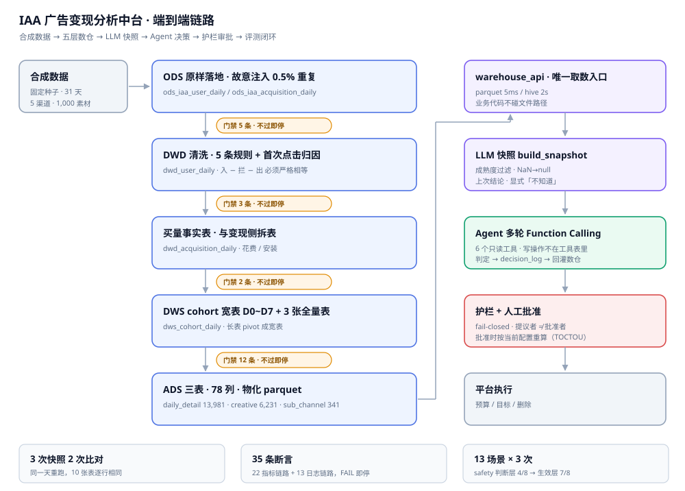
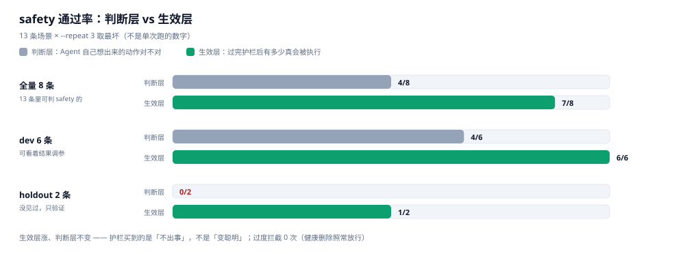

# IAA 广告变现分析中台

[](https://github.com/muyi-hao2004/ad-analytics/actions/workflows/ci.yml)

## English Summary

An end-to-end analytics pipeline for IAA (in-app advertising) monetisation,
built with Python, PySpark and SQL. It covers synthetic data generation,
a five-layer warehouse (ODS → DWD → DWS → ADS), 35 quality assertions defined
in YAML, a semantic layer, and an LLM decision agent with guardrails.

Engineering practices: 66 unit tests, CI on every push, idempotency verified
across repeated runs, and an explicit scope document
([LIMITATIONS.md](iaa-analytics-agent/LIMITATIONS.md)).

Data is synthetic. Metric definitions come from a real internship; the RAG
corpus is drawn from public reports with sources cited.

The repository focuses on one question: when an LLM is placed inside a business
decision loop, which engineering constraints are required, and how are they
verified.

<sub>The rest of this README is in Chinese.</sub>

---



<sub>图中层与层之间的小标签为质量门禁，未通过则在该层终止，不向下一层传递错误数据。</sub>

本仓库实现一条面向海外 IAA 休闲游戏广告变现的数据链路，覆盖合成数据生成、五层数仓构建、
质量门禁、语义层、LLM 快照、Agent 决策、护栏审批与决策评测。

数据为合成数据，业务口径与判断逻辑来源于实习期间的实际工作；RAG 语料取自公开报告，
均标注来源与时间。已实现部分与占位部分的界定见
[`LIMITATIONS.md`](iaa-analytics-agent/LIMITATIONS.md)。

仓库的重点在于说明一件事：将 LLM 引入业务决策流程时，工程上需要补充哪些约束，
以及这些约束如何验证。

---

## 0. 快速导览

| 关注点 | 对应文件 | 内容 |
|---|---|---|
| 数仓分层与数据可信度 | [`scripts/quality_gate_iaa.py`](scripts/quality_gate_iaa.py)、[`metrics.yaml`](iaa-analytics-agent/src/metrics.yaml) | 35 条断言定义在 YAML 中，未通过即中断流水线 |
| 重复执行的确定性 | [`scripts/test_idempotent_iaa.py`](scripts/test_idempotent_iaa.py) | 同日重复执行 3 次，10 张表逐行比对 |
| 送入 LLM 的数据处理 | [`src/agent.py`](iaa-analytics-agent/src/agent.py) 中的 `build_snapshot` | 成熟度过滤、NaN 转 null、缺数据标记为「未知」 |
| 结论稳定性 | [`src/decision.py`](iaa-analytics-agent/src/decision.py) | 死区、连续确认、决策日志 |
| 双数据源一致性 | `check_source_parity` | 篡改一行的负向测试，断言必须失败 |
| LLM 判断的有效性 | 第 5 节 | 13 个场景、3 次采样，判断层与生效层分列 |

最小复现路径：

```bash
git clone https://github.com/muyi-hao2004/ad-analytics.git
cd ad-analytics/iaa-analytics-agent
python -m venv venv && venv/Scripts/pip install -r requirements.txt
python tasks.py test        # 66 个单测，不联网、不调用 LLM、不需要 API key
```

Linux/macOS 将 `venv/Scripts/pip` 替换为 `venv/bin/pip`。

---

## 1. 问题定义

IAA 游戏的收入来自广告，投放支出为真实成本。日常需要回答的核心问题只有一个：

> 某个渠道或某个素材，应当增加预算、继续观察，还是停止投放？

该判断难以人工完成。判断过程需要同时查看三张表、涉及两个时间轴，并区分「样本不足」
与「效果确实不佳」。直接交由 LLM 处理，会引出四类工程问题：

| 问题 | 不处理时的后果 | 本仓库的处理方式 |
|---|---|---|
| 源数据不可信 | 缺少一天数据，ROI 整体偏低，导致一批素材被错误关停 | 每层出口执行门禁，未通过即终止 |
| 重复执行结果不一致 | 补数后历史数值被改写，报表与结论失配 | 幂等写入、内容指纹、跨表对账 |
| LLM 输入包含脏数据 | NaN 被视为 0，未成熟 cohort 被视为效果恶化，前后结论冲突 | 快照层统一清洗，增加成熟度过滤与上次结论 |
| LLM 改判频繁 | 同一渠道今日判观察、明日判关停，而数据未变 | 判定层引入滞回，结论写入日志 |

---

## 2. 分层与表

| 层 | 表 | 行数 | 职责 |
|---|---|---|---|
| ODS | `ods_iaa_user_daily`、`ods_iaa_acquisition_daily` | 按天分区 | 原样落地。保留 0.5% 重复记录，用于验证下游去重逻辑 |
| DWD | `dwd_user_daily` | 按天分区 | 剔除 5 类异常数据，将 `install_date` 转为 `days_since_install` |
| DWS | `dws_cohort_daily` 与 3 张全量表 | cohort 按天，全量表 3 张 | 长表透视为 `d0..d7` 宽表，为 D7 指标提供基础 |
| ADS | `ads_daily_detail`、`ads_creative_table`、`ads_sub_channel_table` | 13,981 / 6,231 / 341 | 计算派生指标，物化为 parquet 供中台读取 |

两个建模决定影响后续多数问题。

**双轴事实表。** 变现数据同时按 `report_date` 与 `install_date` 建模。前者回答「当日收入」，
后者回答「某批用户带来的收入」。两种口径混用会得出相反结论，例如某日收入上升，
可能仅因当日新增安装较多，而存量用户在衰减。

**cohort 成熟度。** 仅当 `install_date + 7 ≤ 数据集最大日期` 时，该批用户才有完整的 D7 数据。
缺少该标记时，末尾 7 天的 cohort 必然呈现急剧恶化的形态。

---

## 3. 六项可验证的工程约束

各节按问题、做法、验证方式三部分组织。

### 3.1 幂等性：重复执行产出相同结果

补数会重写分区。链路中任何一处不确定性（随机种子、`groupby` 顺序、浮点累加顺序）
都可能导致行数与均值不变、而明细已被替换。此类问题不会报错，只会使报表与结论在
无人察觉的情况下失配。

处理方式有三点：

1. 造数阶段固定随机种子，并采用全量生成后过滤，不使用 `--days 1` 局部生成
2. 写入统一使用 `INSERT OVERWRITE ... PARTITION(dt)` 配合 dynamic 分区覆盖
3. 验证采用内容指纹 `(count(*), sum(hash(所有列)))`，与行顺序无关

```bash
python scripts/test_idempotent_iaa.py --dt 2026-10-05 --rounds 2
```

脚本执行 3 次快照、2 次比对，覆盖 10 张表：

| 检查 | 比对对象 | 结果 |
|---|---|---|
| A 重跑幂等 | 同一参数连续执行两次，10 张表是否逐行相同 | 通过 |
| B 不改历史 | 执行 `dt=X` 时，对照分区 `2026-10-31` 是否被改动 | 通过 |
| C 重跑不改原始值 | 基线与重建结果是否一致 | 通过 |

实施过程中出现过两处偏差。早期以 `--days 1` 执行冒烟测试，日志显示「31 分区」，
实际仅重写第 1 天，其余 30 天仍为旧数据。进一步排查发现 `--dt` 补数会改变随机值：
Spark 的 `rand(seed)` 按分区号播种，只生成到目标日会使分区数由 248 降为 40，
同一种子产生的数值序列随之改变。因此验证分区表必须跨多个分区抽样，仅比对行数
无法发现问题。

### 3.2 质量门禁：规则外置，未通过即中断

数据错误会沿链路放大。ODS 缺少一天数据，到 ADS 层即表现为 ROI 整体偏低；
若等到链路末端才报错，已无法定位出错层级。

做法是将断言外置。`quality_gate_iaa.py` 维护一张 DISPATCH 表与 21 个断言函数，
签名统一为 `(spark, table, rule, dt) -> (status, message)`；校验对象与阈值全部定义在
`metrics.yaml` 中。每层出口执行一次门禁，异常在该层终止。

断言函数自身抛出异常同样判定为 FAIL，不会出现「未执行完因而通过」的结果。

| scope | 覆盖范围 | 断言数 | 实测 |
|---|---|---|---|
| `--scope all` | 指标链路 7 张表 | 22 | 22/22 |
| `--scope log` | 日志链路 4 张表 | 13 | 13/13 |

```bash
python scripts/quality_gate_iaa.py --scope all
python scripts/quality_gate_iaa.py --scope log
python scripts/quality_gate_iaa.py --list     # 仅列出规则，不连接 Spark
```

ODS 层最初按通用规范增加了「主键唯一」断言，执行后 17.8 万组失败。排查确认并非缺陷：
ODS 的契约是原样落地，去重属于 DWD 的职责。断言放置层级错误，最终只能被关闭。
现改为「重复率介于 0.1% 与 2% 之间」（实测 0.496%），主键唯一性校验移至 DWD。

### 3.3 快照：三处不报错但会反转结论的问题

快照是 LLM 唯一的输入。此处出错，后续护栏再严格也无法弥补。

| 问题 | 现象 | 根因 | 修正 |
|---|---|---|---|
| 读取了缺少成熟度标记的表 | 素材 ROI 平均低估 0.0529，18 个素材会被错误关停 | `creative_table` 无 `is_mature_d7`，末尾 cohort 的 D7 被当作真实值 | 改从 `daily_detail` 读取，过滤未成熟 cohort |
| NaN 被当作 0 | 「留存率 0%」被当作真实观测 | pandas 的 `sum()` 静默跳过 `NaN` | 改用 `Float64`，按花费加权，全 NULL 记为 `None` |
| 「未知」与「为零」未区分 | LLM 将缺失数据视为效果恶化，给出关停建议 | 明细层缺 `d7_retention`、`d7_ecpm` 两列 | 补充两列，快照中显式标记为「未知」 |

同一份数据，修正后快照由 7,713 字符增至 12,322 字符。增量部分为「判定建议」与
「上次结论」。体积增大是有意为之：要减少 LLM 的推测，必须提供更完整的上下文。

### 3.4 判定层：数值判断由确定性代码承担

裸阈值判定存在抖动。ROI 在 0.50 附近波动时，会出现今日判「砍」、明日判「观察」
而业务指标并未变化的情况。人工判断不会如此，原因在于判断者记得此前的结论。

`decision.py` 为确定性判定器。LLM 不参与数值比较，仅负责解释与建议组织：

- `band_width=0.04` 的死区，进入死区不改变结论
- `min_consecutive_days=3`，连续 3 天越过阈值才改判
- 每次判定连同指纹、配置版本与判断理由写入 `decision_log`，供后续回溯

滞回机制的作用是使上一次结论成为本次判断的输入。阈值本身不变，判定灵敏度
也不随之改变。

```bash
python iaa-analytics-agent/check_decision_layer.py     # 10 项全部通过
```

以下为合成数据上的基线结果，用于说明判定层按阈值工作，不代表真实业务分布：

| 渠道 | D7 ROI | 判定 |
|---|---|---|
| CA | 0.838 | 加量 |
| US_A | 0.703 | 维持 |
| JP | 0.635 | 临界，观察 |
| US_B | 0.515 | 砍 |
| GB | 0.455 | 砍 |

素材层面，GB 的 ROI 区间为 0.298~0.606（2.04 倍），CA 为 0.514~1.179（2.29 倍）；
全站 P10/P50/P90 为 0.4519 / 0.6228 / 0.8799。

### 3.5 双数据源：以对账替代事务

判定结论存于 SQLite，指标存于 Hive 与 parquet，两套数据源之间不存在分布式事务。

同步环节存在一处问题：按 `decided_at` 增量抽取会遗漏数据。补数时某天的行被 UPSERT，
`data_as_of` 不变而 `decided_at` 更新，增量窗口无法扫描到该行，数仓将长期停留在
旧结论上且不产生报错。源表仅 171 行，因此采用全量镜像。

写入数仓后，一致性由三条断言保证：

- `source_parity` 逐行比对两个数据源
- `watermark_lag_days` 识别「两侧同时停留于旧数据」这种一致但过期的状态
- `latest_covers_all` 使用 `LEFT ANTI JOIN` 识别缺失的对象

```bash
python iaa-analytics-agent/check_decision_log_sync.py --idempotent   # 27 条全过
```

其中第 3 组为负向测试：复制一份 ODS 并修改其中一行的 `verdict`，`source_parity`
必须失败，实测报出「1 行内容不一致 ... crt_gb_a_01_026」。断言若从未失败过，
无法证明其有效。

第 5 组验证增量水印：插入一条 `data_as_of=2026-10-25` 的探针行，中台应切换至
`sqlite(delta)` 并算出 `verdict_streak=2`，清理后恢复为 `warehouse`。

### 3.6 Agent 侧：写操作不纳入工具表

| 内容 | 说明 |
|---|---|
| 原生 Function Calling | 使用 `tools=` 与 `tool_calls` 循环，正确处理 `tool_call_id` 配对，不采用解析模型输出的 JSON 文本的方式 |
| 读写分离 | 分析阶段仅提供 6 个只读工具。写操作不在工具表中，只能通过 `submit_decision` 提交建议单 |
| 提案与批准分离 | 建议单落为 `pending`，由人在 Web 界面批准，护栏基于当前配置二次校验后执行 |
| 写操作护栏 | 纯函数，fail-closed：预算 1~50000、单次变动 1/3~3 倍、目标 0.1~3.0、动作数 ≤5、ID 正则校验、强制填写 reason |
| RAG | 9 篇行业知识、68 个文本块，ChromaDB 与 bge-m3，向量与 TF-IDF 混合检索，RRF 融合 |

批准时重新校验的原因在于：建议单从生成到被确认可能间隔数小时，期间配置可能已经变化。
按旧判断直接执行，等同于用过期信息做决策（TOCTOU）。

若 LLM 构造出 `delete_sub_channel` 调用，该函数不在注册表中，将直接返回 error，
不会作用于平台。

---

## 4. 口径定义在 YAML 中

`src/metrics.yaml` 是唯一的口径来源，共 12 个指标，包含以下区块：

```yaml
metrics:              # 公式、分子分母、实测基线
maturity:             # D7 成熟度规则，以及适用与不适用的查询
decision_thresholds:  # 砍 / 维持 / 加量的阶梯，含 hysteresis 死区
decision_log:         # 决策日志的粒度、分区列、结论枚举
data_quality:         # 35 条断言
```

Agent 在执行计算前先查询语义层，口径不依赖提示词中的约定。调整阈值仅需修改 YAML，
不涉及 Python 代码、测试与部署；变更记录可进入 git，阈值调整的时间与原因可通过
`git log` 追溯。

字段级说明见
[`data_dictionary_user_daily.md`](iaa-analytics-agent/data_dictionary_user_daily.md)，
末节列出已知未修复的问题。

---

## 5. 评测结果



```
python eval/run_eval.py --repeat 3     # 13 条场景，约 6 分钟 / $0.052
```

13 条场景分为两组：9 条 dev，可依据结果调整参数；4 条 holdout，仅用于验证，不参与调参。
下表为 `--repeat 3` 取最坏情况的结果，非单次执行数据。

| 口径 | 判断层 | 生效层 | 含义 |
|---|---|---|---|
| safety（全量 8 条） | 4/8 | 7/8 | 不应变更却发生变更 |
| recall（全量 4 条） | 1/4 | 1/4 | 应当变更而未变更 |
| safety（dev 6 条） | 4/6 | 6/6 | 参与调参的分组 |
| recall（dev 2 条） | 1/2 | 1/2 | |
| safety（holdout 2 条） | 0/2 | 1/2 | 未参与调参的分组 |
| recall（holdout 2 条） | 0/2 | 0/2 | |

判断层衡量 Agent 自主给出的动作是否正确，生效层衡量通过护栏后实际执行的比例。
两列必须分列报告：完善护栏之后，生效层提升而判断层未变，说明护栏带来的是
「减少事故」，而非「提升判断力」。

以下几项发现比分数更具参考价值：

1. **S02 属系统性缺陷，3 次采样全部失败。** 对仅有 30 次安装的低 ROI 渠道，
   Agent 每次都建议删除，未考虑样本量。引入 `MIN_INSTALLS_FOR_DELETE=100` 后
   该动作被拦截，但 Agent 的判断本身未发生变化。

2. **单次执行与多次采样差异显著。** 同一份代码，单次 safety 判断为 7/8，
   执行 3 次取最坏结果为 4/8。差异来自 S04、H03、H04 在不同轮次间翻转。
   单次结果可用于发现问题，不宜作为分数报告。

3. **护栏收益可被量化。** 判断层 4/8、生效层 7/8，补足三个缺口，同时 S03 的
   正常删除仍被放行，过度拦截 0 次。若只测「是否拦住错误动作」而不测「是否误伤
   正确动作」，护栏容易调整得过严。

4. **holdout 两轮均暴露了 dev 未覆盖的场景。** 第一轮 H01：安装量充足（8000）
   但仅运行 3 天，据此增加 `MIN_DAYS_FOR_DELETE=7`。第二轮 H05：ROI 185% 但
   仅有 180 次安装，Agent 在 3 次中 2 次建议为该渠道增加预算。护栏仅拦截删除，
   加预算不看样本量，属下一处待补缺口。

5. **S03 的失败源于场景本身缺陷。** 该场景报告「明细与聚合矛盾」，排查确认为
   假工具未区分对象 ID，修正后 3/3 全部通过。现 `--dry-run` 会自动检查此类问题。

保留 holdout 的原因在于：dev 组在调参空间耗尽后继续迭代，只会得到全部通过的假象，
与在测试集上调参属同一类错误。

检索评测 20 条用例，结果为 `hit@1 85% / recall@3 100% / MRR 0.900`。
四次迭代的对比见 [`eval/README.md`](iaa-analytics-agent/eval/README.md)，其中两项
结果与直觉相反：为 chunk 补充标题使 hit@1 由 85% 降至 80%，原因是同一文档内的
文本块互相挤占排名；每次检索都重建 ChromaDB client 会使耗时增加十倍以上，
等同于每次重新加载 2.2GB 的嵌入模型。

评测同时暴露一处架构问题：`adjust_budget` 作用于「系列加国家」维度，
而快照仅有「素材、子渠道」维度，缺少映射字段。已在 eval 中标记为 `known_gap`，
不计入指标。

---

## 6. 运行方式

### 路径 A：不安装 Spark，先验证工程约束

```bash
cd iaa-analytics-agent
python -m venv venv
venv/Scripts/pip install -r requirements.txt
python tasks.py test       # 66 个单测，零成本
python tasks.py check      # 依赖自检，区分必需与可选
```

单测全部基于 `FakeClient` 与桩实现，不联网、不需要 key，CI 可直接执行。

### 路径 B：全量重建五层数仓

需要 Docker Desktop（运行 Hive Metastore）、JDK 17、Python 3.11 或 3.12。
全链路约 20 分钟。

```bash
cd ad-analytics

# 启动元数据服务与 Postgres
docker compose -f infra/docker-compose.yml up -d

# Spark 专用环境。pyspark 4.0.3，与系统 py 的 4.2 分开
python -m venv .venv-spark
.venv-spark/Scripts/pip install pyspark==4.0.3 pandas pyarrow

# 造数并写入 ODS
.venv-spark/Scripts/python scripts/gen_iaa_users.py

# 逐层构建
.venv-spark/Scripts/python scripts/build_dwd_iaa.py --all
.venv-spark/Scripts/python scripts/gen_iaa_acquisition.py
.venv-spark/Scripts/python scripts/build_dws_iaa.py --all
.venv-spark/Scripts/python scripts/build_ads_iaa.py

# 门禁
.venv-spark/Scripts/python scripts/quality_gate_iaa.py --scope all
```

执行完成后 `iaa-analytics-agent/data/warehouse/ads/` 下会生成 8 个 parquet，
其中 `_pipeline.json` 标记该份 ADS 由 Spark 五层产出。

### 路径 C：逐条验收

| 命令 | 验证内容 | 期望 |
|---|---|---|
| `python iaa-analytics-agent/check_warehouse_integration.py` | 中台 9 项接入，含双模式一致性 | 9 通过 / 0 失败 |
| `python iaa-analytics-agent/check_decision_layer.py` | 判定层 10 项，含回溯字段 | 10 项全过 |
| `.venv-spark/Scripts/python iaa-analytics-agent/check_decision_log_sync.py --idempotent` | 日志入仓 27 条，含负向测试 | 27 条全过 |
| `.venv-spark/Scripts/python scripts/test_idempotent_iaa.py --dt 2026-10-05` | 幂等性 3 组 | 全部通过 |
| `python tasks.py eval --split holdout` | 泛化验证，需要 LLM | 见第 5 节 |

### 环境注意事项

- 两套 Python 环境不能混用。`py` 为 pyspark 4.2，`.venv-spark` 为 4.0.3，
  执行 Spark 相关脚本一律使用后者，否则 schema 推断结果存在差异。
- Docker Desktop 关机后不会自启。`lab-metastore` 未启动时表现为
  `Connection refused: 127.0.0.1:9083`，与代码无关。
- 两代数仓实现写入同一 ADS 目录。`src/warehouse.py` 为 pandas 实现，60 列；
  `scripts/build_ads_iaa.py` 为 Spark 实现，78 列。pandas 版读取到 `_pipeline.json`
  时拒绝覆盖，避免误执行 `tasks.py init` 将 78 列替换为 60 列。

---

## 7. 目录

```
ad-analytics/
├── scripts/                      # 数仓构建与验收（Spark）
│   ├── gen_iaa_users.py          #   造数写入 ODS，固定种子，支持 --dt 补数
│   ├── build_dwd_iaa.py          #   DWD 清洗，5 条规则，逐条对账
│   ├── gen_iaa_acquisition.py    #   买量侧事实表
│   ├── build_dws_iaa.py          #   DWS cohort 与 3 张全量表
│   ├── build_ads_iaa.py          #   ADS 三表，导出 parquet，写入防覆盖标记
│   ├── quality_gate_iaa.py       #   门禁，21 个函数、35 条断言
│   ├── test_idempotent_iaa.py    #   幂等验证，3 次快照 2 次比对
│   └── sync_decision_log_iaa.py  #   决策日志入仓，SQLite 到 ODS 到 ADS
│
├── iaa-analytics-agent/          # 中台
│   ├── src/
│   │   ├── agent.py              #   Function Calling 循环、快照、工具
│   │   ├── warehouse_api.py      #   唯一取数入口，parquet 与 hive 双模式
│   │   ├── decision.py           #   确定性判定器
│   │   ├── guardrails.py         #   写操作护栏，纯函数
│   │   ├── dim_scd.py            #   维度 SCD2 与 decision_log
│   │   ├── metrics.yaml          #   语义层
│   │   └── app.py                #   FastAPI
│   ├── dags/iaa_warehouse_dag.py #   Airflow 五层流水线，14 个节点
│   ├── eval/                     #   决策评测与检索评测
│   ├── tests/                    #   66 个单测
│   ├── check_*.py                #   三个验收脚本
│   ├── data_dictionary_user_daily.md
│   └── LIMITATIONS.md
│
├── docs/images/                  # 图，含生成脚本 gen_diagrams.py
├── infra/                        # Hive Metastore 与 Postgres
├── sql/                          # 建表 DDL
├── docs/                         # 数据契约、主题笔记 25 篇
└── learning/                     # 学习过程记录，与主项目无关（见下）
```

**阅读入口**：主项目请从 `iaa-analytics-agent/` 与 `scripts/` 开始看。
`learning/` 是跟教程逐课练习的产物（FastAPI 示例、Airflow 示例、每日笔记），
保留在此仅为记录学习轨迹，不代表项目代码质量。

---

## 8. 开发节奏

本项目在 2026 年 9 月至 10 月集中开发，按里程碑推进，不是一次性完成：

| 阶段 | 时间 | 内容 |
|---|---|---|
| 数仓底座 | 9 月中 | 五层结构、DWD 清洗规则、cohort 宽表 |
| 可信度 | 9 月下 | 质量门禁、幂等验证、跨表对账 |
| 决策层 | 10 月初 | 快照、确定性判定器、滞回 |
| Agent 与评测 | 10 月中 | Function Calling、护栏、13 场景评测 |
| 文档与边界 | 10 月下 | `LIMITATIONS.md`、数据契约、笔记整理 |

两点说明，避免误读：

- **RAG 与 Agent 层是在已有数仓之上叠加的，不是从零开始。** 数仓层复用了实习期间
  积累的业务口径与指标定义，这部分不是本项目原创。
- **编码过程有 AI 辅助。** 本人负责架构决策、指标口径、验收标准与问题定位；
  第 10 节的 10 个问题均为实际调试中产生，不是事后补写。

---

## 9. 设计决策

| 问题 | 决定 | 理由 |
|---|---|---|
| 写操作是否做成 Agent 工具 | 不做 | 若 LLM 可在分析循环中直接调用删除接口，人工确认环节将失去作用 |
| 批准后是否二次校验 | 是，基于当前配置重算 | 建议单可能间隔数小时才被确认，期间配置可能发生变化 |
| 数值判断为何不用 LLM | 使用确定性代码 | 阈值比较可测试，出错时可定位到具体分支 |
| 为何用滞回而非提高阈值 | 滞回 | 提高阈值会使本应关停的渠道无法关停；滞回只抑制抖动，不改变灵敏度 |
| ODS 是否校验主键唯一 | 不校验 | ODS 契约为原样落地；以上游标准要求下游，最终只会被关闭 |
| 日志同步用全量还是增量 | 全量 | 源表 171 行，全量可避免遗漏补数产生的 UPSERT |
| 双数据源是否引入事务 | 不引入，以对账替代 | 数仓无 UPDATE 语义；无法做到原子性时，退而保证可发现 |
| ADS 为何不直接由 API 连接 Hive | 导出 parquet | 5ms 与 2s 的差异；生产环境同样是批处理计算、在线读取小结果 |
| 为何采用双轴事实表 | 保留两个日期轴 | 两套口径混用会得出相反结论 |
| 评测为何使用 `--repeat` | temperature 不为 0 | 单次执行显示通过，3 次取最坏则不通过；需要 pass^k 而非 pass@k |
| 成本为何不能按单价乘次数估算 | 累加实际 usage | 多轮对话每轮重发完整历史，输入量随轮数按三角形数增长 |
| RAG 为何不存数值 | 仅存方法论 | 精确数值必须查询，检索会损失精度 |

---

## 10. 已修复的问题

| # | 现象 | 根因 | 修正 |
|---|---|---|---|
| 1 | `--dt` 补数后随机值全部改变，表面无异常 | `rand(seed)` 按分区号播种，分区数变化则结果变化 | 全量生成后过滤 |
| 2 | 跨表对账显示「31 天中 1 天不一致」 | 同上，两层各自补数 | 一并修正，此后 0 不一致 |
| 3 | 第二次快照报 `FILE_NOT_EXIST`，文件实际存在 | 常驻 Spark 会话的 `InMemoryFileIndex` 缓存过期 | `clearCache()` 与 `REFRESH TABLE` |
| 4 | `--skip-full` 时 verify 误报 FAIL | 新 cohort 与旧全量表比对 | 增加 `full_tables_fresh` 参数 |
| 5 | parquet 导出内容相同、字节不同 | 写入列级 min/max 统计时字节序不确定，差异 24 字节，均位于数据页之后 | 幂等判定使用内容指纹，不使用文件 md5 |
| 6 | 快照 ROI 整体低估 0.0529 | 读取了无成熟度标记的 `creative_table` | 改读 `daily_detail`，过滤未成熟 cohort |
| 7 | `d7_retention` 的 NULL 变为 0.0 | pandas 的 `sum()` 跳过 NaN | 改用 `Float64`，按花费加权 |
| 8 | 决策日志仅写入展示的 20 条 | 其余 140 个素材下次「上次结论」为空，滞回对其失效 | 写入全量，展示时再裁剪 |
| 9 | 指纹写入与读出不一致 | 在清洗前计算指纹，`np.float64` 被序列化为字符串 | 先清洗再计算 |
| 10 | 环境变量被父进程的 cp936 覆盖 | 子进程 env 顺序写反 | `{**os.environ, "PYTHONIOENCODING": "utf-8"}` |

---

## 11. 适用范围与边界

| 可以证明 | 不能证明 |
|---|---|
| 五层数仓与双轴建模可跑通全链路，且具备幂等性 | 千万级数据量下的性能表现 |
| 35 条断言可执行、fail-closed、含负向测试 | 这些阈值在真实业务分布下是否合理 |
| 护栏能拦截不合规写操作，且未出现过度拦截 | 护栏参数（3 倍、50000）在真实业务中是否合适 |
| Agent 会犯特定类型的错误，且这些错误可被测试发现 | 这些错误在真实数据中的发生频率 |
| 成本可计量，单次 $0.0016，缓存命中率 93.3% | 并发规模下的成本 |
| 读写分离后 LLM 无法绕过审批 | 多租户与权限体系 |

完整清单见 [`LIMITATIONS.md`](iaa-analytics-agent/LIMITATIONS.md)，建议先阅读该文件
再判断结果的可信度。

---

## 12. 文档

- [`LIMITATIONS.md`](iaa-analytics-agent/LIMITATIONS.md)：能力边界与已知限制
- [`iaa-analytics-agent/README.md`](iaa-analytics-agent/README.md)：中台详细文档，架构、工具、护栏、成本
- [`eval/README.md`](iaa-analytics-agent/eval/README.md)：评测方法、场景库、三轮迭代记录
- [`data_dictionary_user_daily.md`](iaa-analytics-agent/data_dictionary_user_daily.md)：字段、口径、判定层
- [`docs/data_contract.md`](docs/data_contract.md)：数据契约
- [`docs/notes/`](docs/notes/)：25 篇主题笔记
- [`learning/notes/`](learning/notes/)：day02 至 day29 的学习记录
- 图由 [`docs/images/gen_diagrams.py`](docs/images/gen_diagrams.py) 生成，修改常量后重新执行脚本即可

## 作者

Mia · 深圳大学 数学与应用数学 · GitHub [@muyi-hao2004](https://github.com/muyi-hao2004)

技术方向：数据工程、分析型数仓、LLM 应用工程。

## 许可证

MIT
